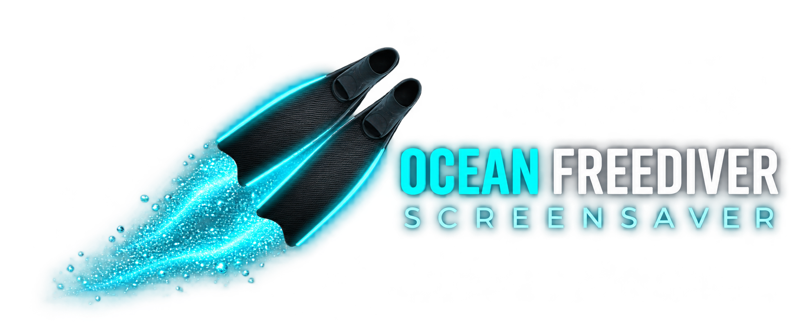
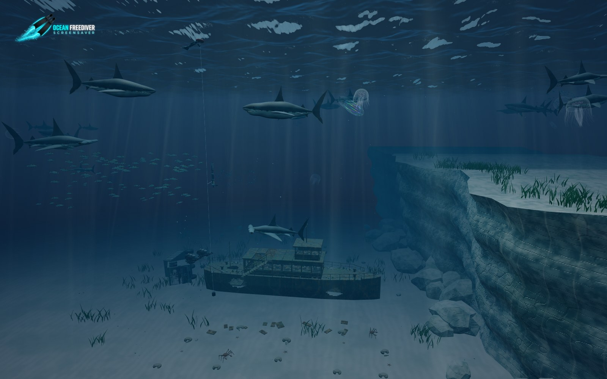
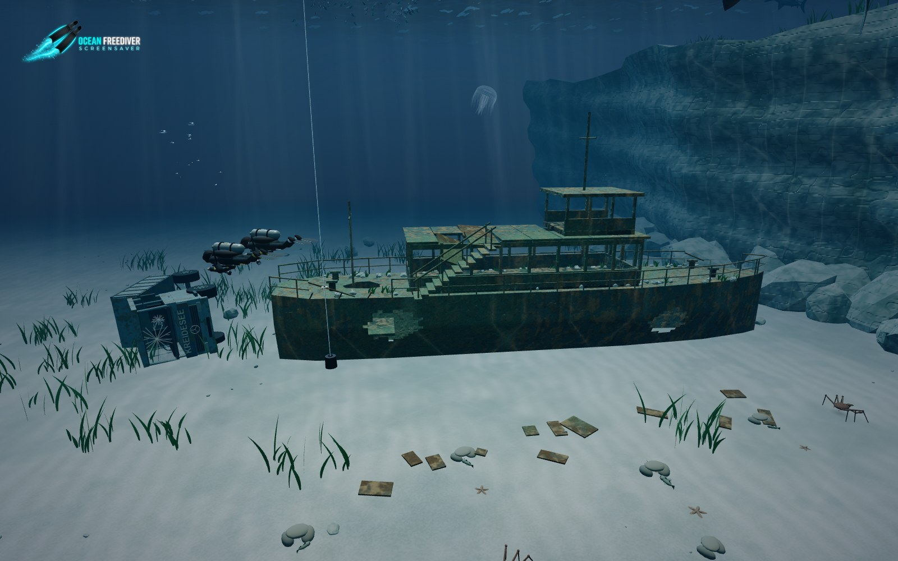
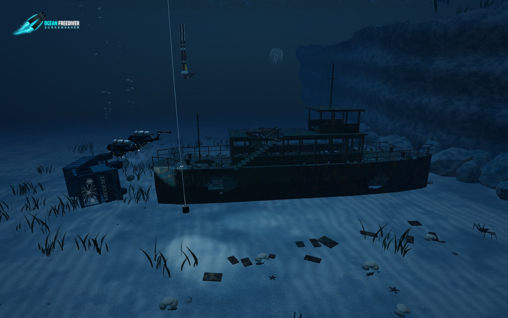
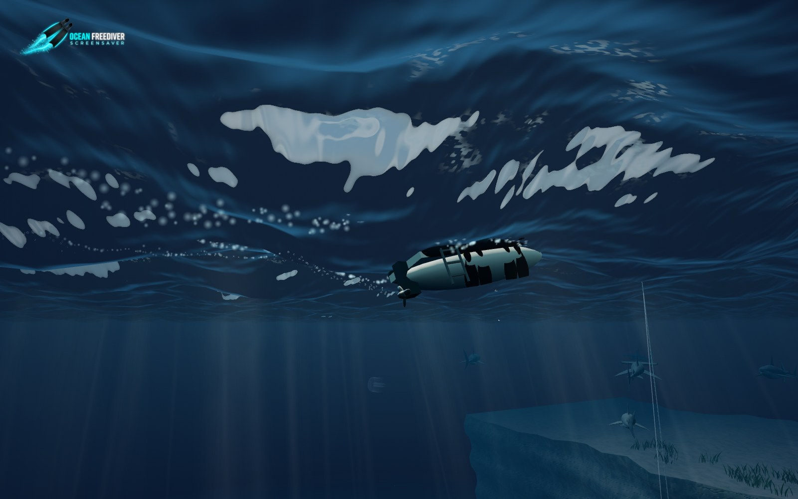

# Ocean Freediver Screensaver

A living underwater scene with freedivers, scuba buddies, sharks, schooling fish and drifting jellyfish. Explore a weathered wreck, a submerged truck and a planted limestone reef under changing daylight and night-time bioluminescence.

Created by **Kristian Rauhe Harreby**. Runs directly in your browser, including offline: no installation, server or build step.

## Start the screensaver

Download or clone this repository, keep its files together, and open **index.html** in Chrome or Edge with graphics acceleration enabled. Select **Fullscreen** or press **F**. This is a browser screensaver, not a Windows screensaver installer.

[Open the hosted version](https://krauhe.github.io/ocean-freediver/) when GitHub Pages is available for this repository.

## What lives in the scene?

- **Freedivers:** articulated 3D monofin and bi-fin divers, wave-following surface rests, duck dives, descents, line-supported bottom turns and safety escorts. The bottom plate is 28 cm in diameter.
- **Scuba stories:** a buddy pair arrives by RIB, rolls backwards into the water one at a time, explores the wreck, truck or reef independently nearby, deploys a marker buoy, makes an accelerated safety stop and returns for pickup. A new pair starts the next cycle. Major depth changes use head-up, fins-down postures.
- **Night diving:** hands, heads and torches look between details. Breathing bubbles rise toward the surface; mechanical disturbance activates scattered, short-lived bioluminescent points.
- **Boats and water:** the RIB follows wave height and slope. Its rotating propeller leaves bubbles and a spreading wake; back-roll entries produce splashes and entrained air.
- **Sharks and fish:** sharks patrol on forward-swimming turns and can leave the view. Individual sardine-inspired fish separate, align, regroup and evade larger swimmers; their flanks glint as they turn in sunlight.
- **Jellyfish and comb jellies:** independent inclinations, slow turns and current-driven drift. Moon jellies pulse along their body axes; comb jellies carry moving rainbow highlights and a separate stimulated night-time flash.
- **Bottom life:** walking king crabs, small fish, shrimp, sea stars, seagrass and algae among rippled sand, gravel and rocks.

These are procedural visual interpretations, not exact reconstructions, species-calibrated simulations or diving instruction. Stop time is compressed for the scene.

## Wreck, truck and reef

The Gozo-inspired ferry has rust, missing panels, hull openings, bent rails and scattered debris. The Kreidesee Hemmoor-inspired truck lies on its side behind it, with lettering on the cab front. The limestone ledge, textured sand and rooted vegetation share the **Wreck & reef** toggle, including the truck.

Textures and geometry are generated locally. Reference photographs are not loaded by the screensaver or bundled as project assets.

## Night-time light and motion

The day/night cycle can follow your local clock or a selected time. Surface waves refract the sky and sunbeams, with moving caustics and underwater shadows. Night lighting is enhanced for visibility.

Bioluminescence consists of individual points in disturbed water. Fin wakes sample whole edges rather than fixed glowing tips; flash positions, timing, lifetimes and local density vary. Points stay in the water after the swimmer passes. The **Bioluminescence** slider spans **0–1200%**, starts at **300%** and remembers your setting.

All screenshots show the current local scene. Detail views use closer inspection cameras.

## Controls

| Control | Action |
| --- | --- |
| **Fullscreen / F / double-click** | Enter fullscreen; Esc exits |
| **Pause / Space** | Freeze or resume the scene |
| **Swimming speed** | Change simulation speed |
| **Animals: Low–High** | Adjust enabled wildlife together; humans are unaffected |
| **Species and scene checkboxes** | Show or hide animals, divers and the wreck/reef |
| **Particles** | Set the preferred marine-snow density |
| **Lighting** | Follow the local clock or choose a time of day |
| **Scuba story / Restart dive** | Choose a dive location or replay the boat-to-pickup sequence |
| **Graphics / Auto** | Choose detail manually or let measured performance adjust it |
| **Left/right mouse drag** | Push/pull sharks or moon jellies; grabbing away from the centre also turns them |
| **Touch drag** | Move and turn an animal in the screen plane |

Click or tap the background to minimize the controls; select **Menu** to reopen them. Controls also fade during inactivity. **The logo remains visible.**

## Adaptive graphics

Every graphics level is capped at **30 fps**. **Auto** aims for 30 fps and lowers detail after sustained performance below approximately 24 fps. Stable performance permits cautious upward trials, with a cooldown after an unsuccessful trial.

Auto adjusts resolution, caustic lighting, sunbeams, school size, wildlife density, grass, tentacles and particles. It preserves your Animals and Particles preferences and leaves the human population alone. Phones and software rendering start conservatively; available GPU information is a hint, with measured performance deciding subsequent adjustments. An extra reduced Eco tier helps slower devices, but no minimum frame rate is guaranteed.

Moving the **Eco / Balanced / High / Ultra** slider switches to manual control. See [GUIDE.md](GUIDE.md) for implementation details and modelling limitations.

## Support the project

This is a free, open-source spare-time project. If you enjoy it and would like to help, you can contribute toward **coffee and AI development costs**. Support is entirely optional — thank you!

- [Buy Me a Coffee](https://buymeacoffee.com/krauhe)
- [Support via MobilePay](https://qr.mobilepay.dk/box/0946757d-b34b-4b1e-8302-f0a67fc49c69/pay-in)

## Development

Vanilla HTML, CSS and JavaScript with a bundled Three.js renderer. All runtime assets are local.

| Files | Purpose |
| --- | --- |
| `ocean.js`, `ocean.css`, `index.html` | Scene, optics, interaction and controls |
| `freediver.js`, `freediver-rig.js` | Articulated freedivers and training rig |
| `scuba.js`, `scuba-scenarios.js`, `diver-bubbles.js` | Buddy animation, dive stories and breathing bubbles |
| `boat-water.js` | Wave-following RIB, wake and entry splashes |
| `marine-behavior.js` | Currents, shark navigation and individual schooling fish |
| `jellyfish.js`, `comb-jelly.js`, `jelly-orientation.js` | Jelly models, light and orientation |
| `seabed.js`, `hemmoor-truck.js` | Sand, reef, wreck, vegetation and truck |
| `king-crab.js`, `benthic-life.js` | Walking crabs and smaller bottom animals |
| `adaptive-quality.js` | Performance-based graphics governor |
| `tests/` | Dependency-free Node checks for quality adaptation and jelly orientation |

Run the included checks with `node tests/adaptive-quality.cjs` and `node tests/jelly-orientation.cjs`.

## Credits and references

**Creator and lead developer: Kristian Rauhe Harreby.** Developed with AI-assisted research and implementation, including OpenAI Codex and Google Gemini.

Visual references include the [MV Karwela wreck](https://en.wikipedia.org/wiki/MV_Karwela), [P. Coors / Tauchernest's Hemmoor photographs](https://www.tauchernest.de/Hemmoor/en/index.html), [Aurelia turning research](https://pubmed.ncbi.nlm.nih.gov/38211351/) and [outboard propeller-wake imagery](https://blenderartists.org/t/how-does-one-create-a-propeller-wake-effect/1408208). Animation is procedural, not motion capture. More references are recorded in [GUIDE.md](GUIDE.md).

## License

Licensed under the **GNU General Public License v3.0 (GPLv3)**. You may use, modify and redistribute the project under the terms of [LICENSE](LICENSE).

Copyright © 2026 **Kristian Rauhe Harreby**.

The bundled Three.js library retains its MIT license in [THREE-LICENSE](THREE-LICENSE).
