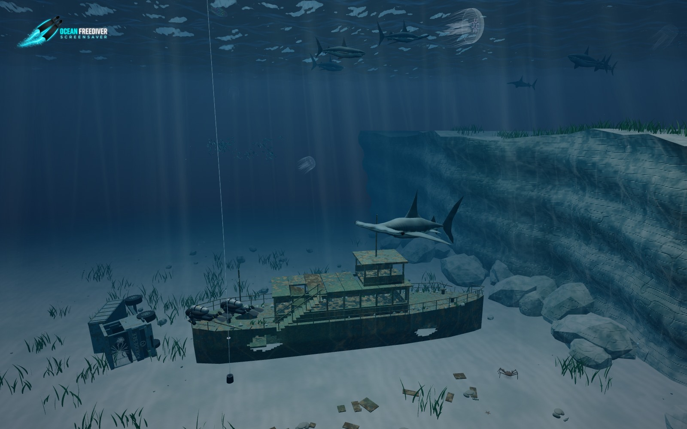

# Ocean Freediver Screensaver

An interactive underwater screensaver by **Kristian Rauhe Harreby**. Freedivers, scuba buddies and marine life explore a wreck, a fallen truck and a planted reef, from daylight to glowing night dives.

**[Open the screensaver](https://krauhe.github.io/ocean-freediver-screensaver/)** · [Detailed guide](GUIDE.md)

## Features

- Articulated freedivers and scuba buddies, back-roll entries, exploration, buoy deployment and boat pickup.
- Sharks, individual schooling fish, drifting jellyfish, walking crabs and smaller bottom animals.
- Waves, moving sunlight, night torches, scattered bioluminescence, bubbles and boat wakes.
- **Auto graphics** adjusts detail toward 30 fps. Wildlife density, lighting and effects are adjustable.

## Get started

Open the link above, or download the repository and open **index.html** locally. No installation or build step; all runtime assets work offline.

**F**: fullscreen · **Space**: pause · Drag animals or divers to interact; on touch, hold to pull closer and drag to steer. Tap the background to hide controls; **Menu** reopens them. The logo stays visible.

The scene is a procedural visual interpretation, not diving instruction. See the [guide](GUIDE.md) for controls and modelling details.

## Screenshots

| Wreck exploration | Night dive |
| --- | --- |
|  |  |

Captured from the current scene; detail views use closer cameras.

## Support the project

If you enjoy this free, open-source project, you are welcome to contribute toward **coffee and AI development costs**. Support is entirely optional — thank you!

**[Buy Me a Coffee](https://buymeacoffee.com/krauhe)** · **[MobilePay](https://qr.mobilepay.dk/box/0946757d-b34b-4b1e-8302-f0a67fc49c69/pay-in)**

## Credits and license

The published website counts visits with a dedicated [GoatCounter dashboard](https://ocean-freediver-screensaver.goatcounter.com/). Local files and localhost previews do not load the counter. Build-query links count as the same screensaver page.

Underwater audio: **“Underwater Ambience.wav” by Tim_Verberne**, from [Freesound](https://freesound.org/people/Tim_Verberne/sounds/482167/), released under [CC0 1.0](https://creativecommons.org/publicdomain/zero/1.0/). The original two-minute stereo loop is bundled in `audio/underwater-ambience.wav`; its CC0 dedication remains separate from the code license. Enable and adjust it under **Sound**; 0% is off. The default volume is 15%; playback starts on the first click, tap or key press.

Motorboat audio: **“water.wav” by n2p5**, from [Freesound](https://freesound.org/people/n2p5/sounds/17494/), licensed under [CC BY 4.0](https://creativecommons.org/licenses/by/4.0/). The original synthesized underwater motorboat recording is bundled unchanged as `audio/underwater-motorboat.wav`; playback is looped, attenuated and faded with boat movement and distance. This asset retains its separate CC BY license. The Sound slider controls both tracks; the boat layer is mixed quietly.

Created by **Kristian Rauhe Harreby**, with AI-assisted development using OpenAI Codex and Google Gemini.

Copyright © 2026 Kristian Rauhe Harreby. Licensed under [GNU GPLv3](LICENSE). Bundled Three.js retains its [MIT license](THREE-LICENSE).
